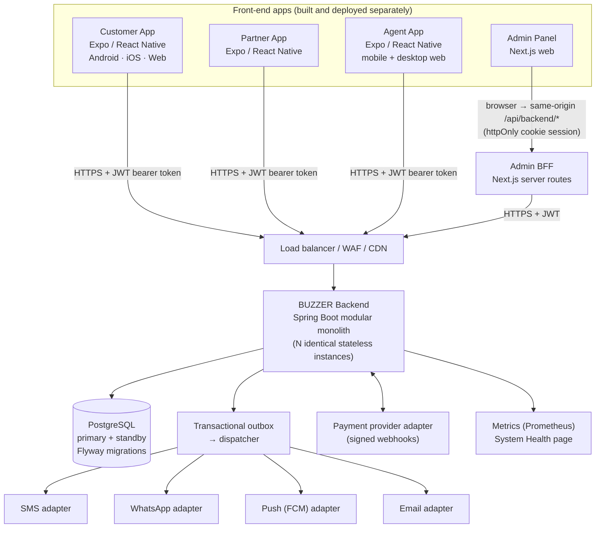
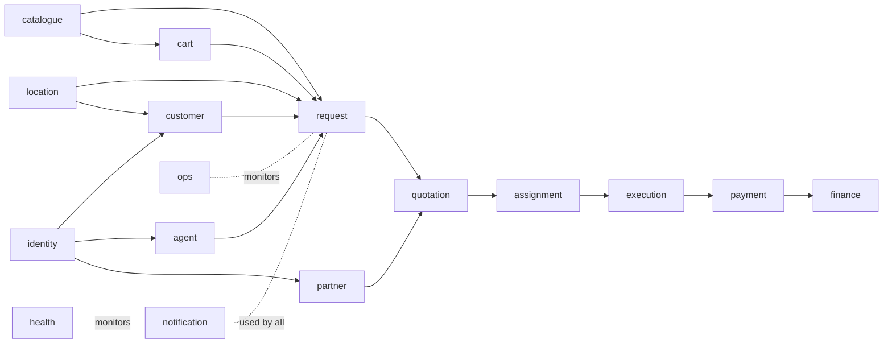
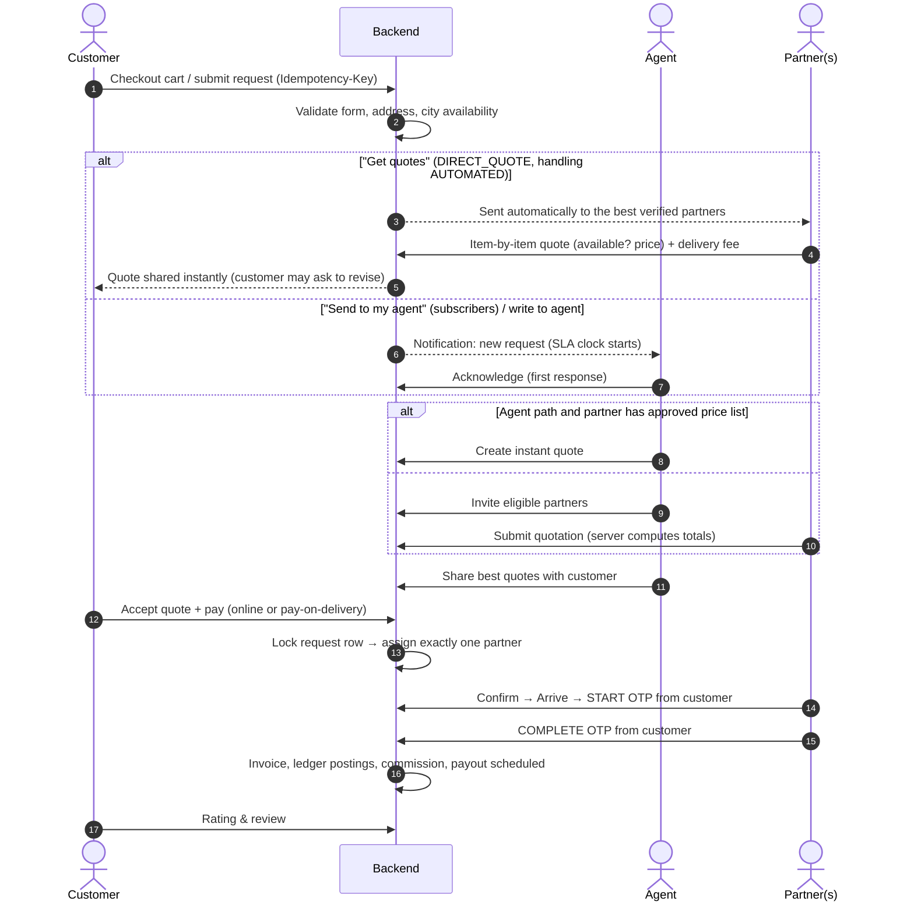
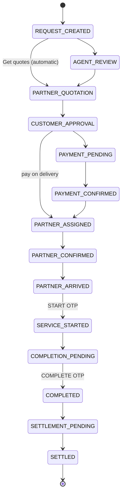
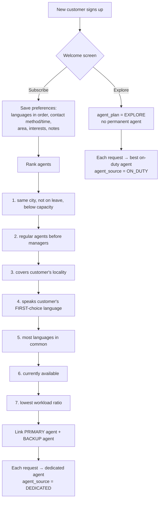
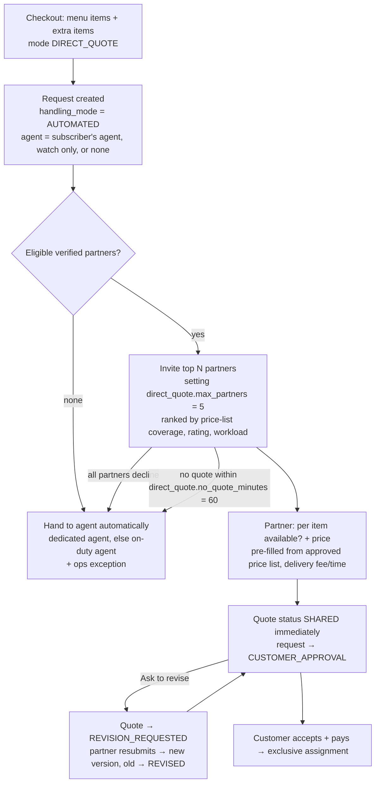
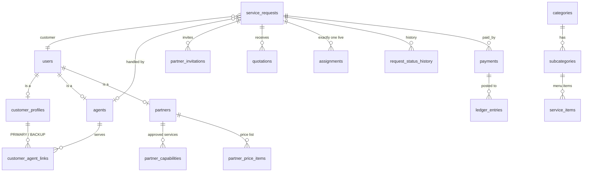

# Architecture

How BUZZER is put together, explained simply first and then in detail.
Related: [Technology stack](technology-stack.md) · [Developer guide](developer-guide.md) · [Business overview](business-overview.md) · [Deployment](deployment.md)

---

## 1. The big picture (in one sentence)

**Four front-end apps talk to one backend over HTTPS; the backend keeps everything in one PostgreSQL database and
talks to outside services (payments, SMS, WhatsApp…) through replaceable adapters.**

**Why this shape?**

| Choice | Reason |
|---|---|
| One backend for all apps | One source of truth for rules (prices, permissions, states). No duplicated logic. |
| **Modular monolith** (not microservices) | Simple to build, test and deploy for a startup; modules are cleanly separated so any one can be split out later if it needs to scale on its own. |
| Stateless backend instances | Run 2, 3 or 10 copies behind a load balancer; any instance can serve any request. |
| PostgreSQL as the source of truth | Strong transactions; critical rules (one partner per job, one accepted quote…) are enforced by the database itself. |
| Adapters for outside services | Test-mode adapters today; swap in Razorpay / an SMS provider later **without touching business logic**. |
| Admin BFF ("backend for frontend") | Admin tokens never reach browser JavaScript — safer against XSS. |

---

## 2. Backend modules

Each module is a Java package `com.buzzer.<module>` that owns its tables and exposes services. Controllers only read
across modules for list views.

| Module | Responsibility |
|---|---|
| `identity` | OTP login, JWT access + rotating refresh tokens, roles, per-app sign-in rules, rate limits |
| `location` | Cities, localities, pincodes, nearest locality from GPS |
| `catalogue` | Categories → subcategories → menu groups → items, pricing types, dynamic forms, deals, search, **Excel import/export** |
| `customer` | Profile, addresses, **dedicated-agent subscription / explore onboarding** |
| `cart` | Cart, wishlist, checkout ("Book now" / "Send to my agent"), write-to-agent |
| `agent` | Agent allocation & language matching, portfolios, agent workspace APIs |
| `partner` | Registration, terms, KYC, capabilities, service areas, eligibility, **price lists** |
| `request` | Request creation, 24-state lifecycle state machine, history, messages, SLA |
| `quotation` | Invitations, quotations, sharing, **instant quotes from price lists**, **direct quotes** (`DirectQuoteService`: automatic dispatch to partners, item-by-item quotes, revisions, automatic hand-over to agents) |
| `assignment` | Exclusive assignment (exactly one partner), decline/cancel, reassignment |
| `execution` | Booking, arrival, START/COMPLETE OTPs, reschedules, overrides |
| `payment` | Payment orders, provider adapter, webhooks, retries, pay-on-delivery |
| `finance` | Ledger, commission rules (+ Excel), invoices, payouts, refunds |
| `notification` | In-app notifications, outbox, dispatcher, channel adapters |
| `ops` | Exceptions, escalations, **transfers**, wings/managers, dashboards, exports |
| `health` | System Health checks for every component |
| `common` | Errors, audit, JSON, settings, Excel helpers, media library, exports |

---

## 3. A request, step by step

### Request lifecycle (state machine)

Side states: `RESCHEDULING_REQUESTED, PARTNER_DECLINED, NO_SHOW, DISPUTED, CANCELLED, REFUND_PENDING, REFUNDED,
REJECTED, EXPIRED`. Allowed moves live in `RequestStatus`; every move writes `request_status_history` and
`audit_events`. `GET /api/v1/admin/request-states` returns the live table.

---

## 4. Agent allocation (dedicated agent subscription)

If nobody is available, the customer stays subscribed, an `NO_AGENT_AVAILABLE` exception is raised for admins, and
allocation is retried on the next request.

## 4b. Direct quotes ("Get quotes") — automation instead of manual agent work

Every automatic step is written to `request_status_history` with actor role `SYSTEM` (status changes via
`RequestRepository.transition`, non-status events via `RequestRepository.note`), which the apps show as a timeline.
The agent inbox orders tickets by *never opened* (`agent_seen_at IS NULL`) first, then agent work, then the rest.

---

## 5. Data model (main tables)

Migrations (`backend/src/main/resources/db/migration`):

| Version | Adds |
|---|---|
| V1 | Core schema: users, roles, OTP, tokens, customers, agents, partners, requests, quotations, assignments, payments, ledger, notifications, outbox, exceptions, audit |
| V2 | Hyderabad + localities, 25 categories, forms, illustrative commission rules, terms |
| V3 | Locality coordinates, image URLs |
| V4 | Cart, wishlist, deals, booking modes, line items |
| V5 | Rich priced menus (repairs, events, travel, dining…) |
| V6 | Menu groups, partner price lists, media library, agent wings |
| V7 | Dedicated-agent subscription (plan, preferences), request `agent_source` |
| V8 | Direct quotes: `handling_mode` (AGENT / AUTOMATED), agent `agent_seen_at` (NEW highlight), hand-over fields, item-level quotation lines + revisions, settings, **Hardware & Supplies** example category |
| V9 | Timeline entries use real clock time so steps in one transaction stay in order |
| `db/devseed` V1000–V1002 | **Dev/test only** staff, partners, deals and a demo hardware shop — never loaded in production |

---

## 6. Reliability principles

- **The database enforces the important rules.** Partial unique indexes guarantee: one live assignment per request,
  one accepted quotation, one active primary/backup agent per customer, unique idempotency keys, unique webhook events,
  idempotent ledger postings.
- **Explicit SQL, explicit locks.** `SELECT … FOR UPDATE` on assignment; `FOR UPDATE SKIP LOCKED` lets many instances
  share the outbox safely.
- **Idempotency everywhere money or requests are created** (`Idempotency-Key` header) — double taps never create
  duplicates.
- **Write first, call out later.** Business records are saved, then messages go through the outbox with retries,
  exponential backoff and a dead-letter queue.
- **Never trust the client.** Totals, prices, eligibility, permissions and state changes are recomputed on the server.
- **Honest status.** Test-mode integrations are labelled in the API, UI and System Health; unknown components never
  show green.

## 7. Security

| Layer | Protection |
|---|---|
| Login | OTP only (hashed, 5-minute expiry, single use, attempt and rate limits); staff apps refuse unknown numbers without revealing whether they exist |
| Sessions | JWT access tokens (30 min) + rotating refresh tokens stored as SHA-256 hashes; reuse is detected and rejected |
| Authorisation | Roles per app (customer, partner, agent, agent manager, support, finance, admin, super admin) + method-level checks; agents see only their portfolio; partners only their own leads/jobs (others return 404) |
| Privacy | Customer contact released to a partner only after booking; KYC numbers masked; OTPs and secrets redacted from logs |
| Admin web | Tokens in httpOnly cookies behind the BFF; proxy allow-list of backend paths |
| Files | Image uploads checked by content (magic bytes), PNG/JPEG/WebP, ≤ 2 MB |
| Spreadsheets | Excel/CSV exports neutralise formula injection |
| Secrets | From environment variables only; dev defaults are clearly marked "change me" |

## 8. Production deployment (target)

See [deployment.md](deployment.md) and the [runbooks](runbooks): multi-AZ load balancer + WAF + CDN, 2+ backend
replicas (Kubernetes reference manifest in `infra/k8s`), managed PostgreSQL with hot standby and point-in-time recovery,
Redis for cluster-wide rate limits (planned), object storage for photos/KYC (planned), Prometheus metrics, and the
in-app System Health page.
