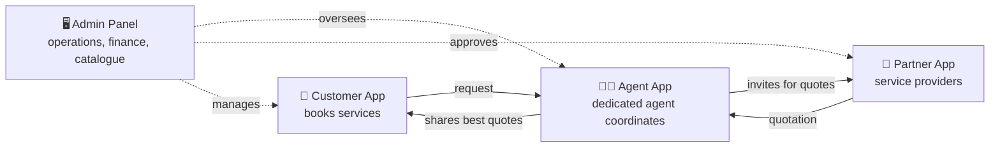
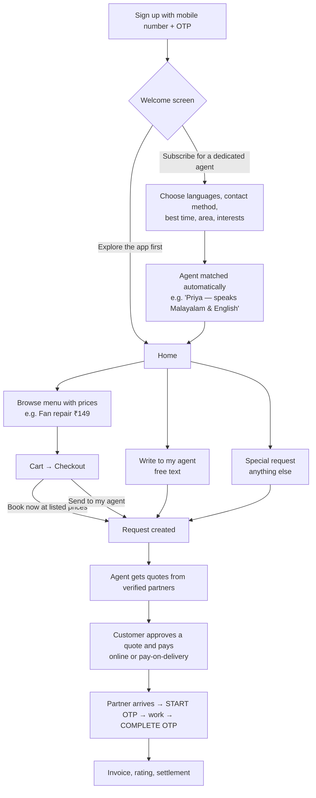
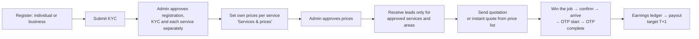

# BUZZER — Business Overview

*You Buzz. We Do.* — Your Personal Assistant for Everyday Life.

This document explains BUZZER **for founders, operations, sales and investors**. No technical knowledge is needed.
For the technical side, see the [Developer Guide](developer-guide.md) and [Architecture](architecture.md).

---

## 1. What is BUZZER?

BUZZER is a **personal-assistant service for everyday needs**, launching in **Hyderabad**.

A customer tells BUZZER what they need — a plumber, an AC service, a wedding photographer, a train ticket, a house to
rent, or "anything else". A **real human agent** (their *dedicated BUZZER agent*) takes ownership, finds **verified
partners** (service providers), gets quotations, and makes sure the job is done properly — from booking to payment to
completion.

> Think of it as **"one phone number for everything at home and in life"**, backed by a trusted person who speaks your
> language, plus a network of checked and approved service providers.

### The problem we solve

| Today, customers… | With BUZZER… |
|---|---|
| Call many vendors, compare prices themselves | One agent compares verified partners and shares the best options |
| Don't know who is trustworthy | Every partner is KYC-verified and approved per service |
| Get no-shows and price surprises | Quotes are fixed before booking; start and finish are OTP-verified |
| Juggle many apps (repairs, tickets, events…) | 25 categories in one app, plus "Special Requests" for anything else |
| Struggle with language and follow-ups | A dedicated agent matched to their language follows up for them |

---

## 2. Who uses BUZZER? (the four apps)

| App | Who | What they do |
|---|---|---|
| **Customer App** (Android, iOS, web) | Households, professionals, families | Sign up, choose a dedicated agent or explore, browse menus with prices, add to cart, book, pay, track, rate |
| **Agent App** (mobile + desktop web) | BUZZER's own staff agents and managers | Handle customer requests, invite partners, compare and share quotes, use instant quotes, follow up, transfer |
| **Partner App** (Android, iOS, web) | Plumbers, electricians, cleaners, photographers, caterers, agencies… | Register, get verified, set their own prices, receive leads, quote, do jobs, get paid |
| **Admin Panel** (web) | BUZZER management, operations, finance, support | Catalogue, approvals, prices, commissions, exceptions, transfers, reports, system health |

---

## 3. The customer journey

### Dedicated agent vs Explore

| | **Subscribed (dedicated agent)** | **Exploring** |
|---|---|---|
| Who handles requests | The same personal agent every time (+ a backup) | Whichever agent is on duty at that moment |
| Matching | Language (first choice counts most), area, availability, workload | Best available agent |
| Shown on Home | Agent card with Call / WhatsApp / Write | "Get your own dedicated agent — Subscribe now" |
| Price | **Free during launch** (paid plans can be added later) | Free |

Customers can subscribe any time from Home or Profile. Existing and agent-registered customers are subscribed
automatically.

---

## 4. The partner journey

**Why partners join:** verified leads (no cold calling), fair exclusive assignment (one job goes to exactly one
partner), clear earnings, and fast payouts.

**Instant quotes:** once a partner's prices are approved, an agent can create a quotation for a customer in **one
tap** from that partner's price list — no waiting for the partner to reply.

---

## 5. The agent's role (the heart of BUZZER)

Agents are BUZZER employees, organised in **wings** (teams, e.g. *Home services*, *Travel*, *Events*) with a
**manager** per wing.

An agent:

1. Responds to new requests within the **SLA** (service-level time limit, e.g. first response within 2 hours).
2. Invites eligible, verified partners for quotes — or uses **instant quotes** from approved price lists.
3. Compares quotes and shares the best ones with a personal note.
4. Follows the job through to completion, handles reschedules, and can record an audited override if the customer's
   phone is unavailable for an OTP.
5. Can **transfer** a request to a colleague or manager (with a reason, recorded in the timeline).

If an agent misses an SLA or goes on leave, the request **escalates automatically**: backup agent → best available
agent → manager. Admins see every breach in **Operational exceptions**.

---

## 6. What we offer — the service catalogue

**25 categories** launch in Hyderabad, each with subcategories and a priced menu:

| Group | Categories |
|---|---|
| Home | Home Repairs & Maintenance (electrician, plumber, AC & appliance, cleaning & pest control, painting, carpentry…), Home Shifting & Setup, Household & Family Assistance, Security & Safety |
| Daily life | Daily Errands & Shopping, Delivery & Logistics, Shopping & Product Sourcing, Vehicle Services |
| Travel & leisure | Travel & Transport (bus, train, flights, holiday & international packages, hotels), Tickets & Reservations, Dining & Entertainment (exclusive deals, restaurants, play zones) |
| Celebrations | Events & Celebrations (birthday, haldi, half-saree…), Wedding & Catering, Photography & Videography |
| Personal | Health & Wellness, Beauty & Personal Care, Education & Career, Matrimony & Social |
| Professional | Real Estate & Property (rent, buy, sell), Professional & Documentation, Legal Services, Financial Services, Business & Office Assistance |
| Work | Quick Jobs & Staffing |
| Anything else | **Special Requests** — "tell us anything" |

**Ways to request:**

- **Menu items with prices** (e.g. *Fan repair ₹149*, *AC service ₹499*) → add to cart → *Book now at listed prices*.
- **Send to my agent** → the agent arranges and quotes.
- **Write to my agent** → free-text request ("Need a cake delivered tomorrow").
- **Requirement forms** for things like real estate, legal or events, so the agent gets complete details.

The catalogue is **managed by admins without any app release** — including bulk editing in **Excel**.

---

## 7. How BUZZER makes money

| Revenue stream | Status | How it works |
|---|---|---|
| **Commission on completed jobs** | ✅ Built | A % of each job (e.g. 5% on plumbing — fully configurable per category, subcategory, item, partner and city, with effective dates). Managed in Admin → Finance, also via Excel |
| **Partner subscriptions / lead charges** | 🔜 Planned | Free / Basic / Premium plans for partners; optional pay-per-lead |
| **Customer memberships** (dedicated agent plans, priority service) | 🔜 Planned | The dedicated agent is free during launch; a paid plan can be switched on later |
| **Digital transactions** (recharge, bills, FASTag, tickets) | 🔜 Planned | Margin per transaction via integration partners |
| **Coupons, referrals, campaigns** | 🔜 Planned | Growth tools |

Money flows through an **append-only ledger** (every rupee is recorded and can be audited): customer payment →
platform commission → partner earning → payout. Refunds always need admin approval.

---

## 8. Trust & safety (why customers and partners can rely on us)

- **OTP login only** — no passwords to steal.
- **Verified partners** — registration, KYC and *each service* are approved separately by admins.
- **OTP-verified work** — a 4-digit START code and COMPLETE code from the customer prove the partner actually came and
  finished.
- **Exactly one partner per job** — enforced by the database, even if two partners accept at the same second.
- **Privacy** — partners see the customer's contact details only after the booking is confirmed; agents only see their
  own customers.
- **Full audit trail** — every status change, transfer, price approval and override is recorded with who, when and why.
- **Advisory notices** for sensitive categories (health, legal, financial, security).

---

## 9. Running the business — Admin Panel at a glance

| Area | What management can do |
|---|---|
| **Dashboard** | Live counts: customers, partners, agents, requests, money collected, commission, SLA breaches, delayed quotes |
| **Requests** | Every request with filters, full timeline, **transfer to another agent** |
| **Customers** | Plan (subscribed / exploring), languages, agents, reassign agent; export |
| **Agents** | Wings, managers, capacity, availability, response times |
| **Partners & KYC** | Approve registrations, KYC, services; partner performance |
| **Price lists** | Approve or reject partner prices (compared with BUZZER's listed price) |
| **Coverage** | Which services have enough partners in which areas |
| **Catalogue** | Categories → subcategories → menu groups → items with prices and images; **Excel import/export** |
| **Finance** | Commission rules (+ Excel), payouts, refunds, payments, reports |
| **Operational exceptions** | SLA breaches, escalations, unassigned work, payment issues — with **assign / transfer** |
| **Settings & SLA** | Response-time rules, city launch, platform settings |
| **System health** | Live status of every part of the platform (green only when really healthy) |

Every list can be **exported to Excel, CSV or PDF**.

---

## 10. Where we are today

| Area | Status |
|---|---|
| Four apps + backend, end-to-end service flow | ✅ Working, tested (41 automated backend tests) |
| Dedicated-agent subscription & language matching | ✅ Working |
| Priced menus, cart, wishlist, checkout, write-to-agent | ✅ Working |
| Partner price lists → admin approval → instant quotes | ✅ Working |
| Excel import/export (catalogue, commission), exports (Excel/CSV/PDF) | ✅ Working |
| Ticket transfers, wings and managers | ✅ Working |
| Payments | 🧪 **Test mode** — needs a payment-gateway merchant account (Razorpay/Cashfree/PayU) |
| SMS / WhatsApp / push / email | 🧪 Test mode — needs provider accounts |
| Maps, photo/KYC uploads to cloud storage | 🔜 Needs cloud accounts |
| Partner subscriptions, customer memberships, coupons | 🔜 Next phase |
| Quick Jobs (staffing), recharge/bills/travel booking engine | 🔜 Later phases |
| Production hosting (high availability, backups, monitoring) | 🔜 Designed — see [deployment](deployment.md) and [runbooks](runbooks) |

### Before going live we need

1. Payment gateway merchant account and keys.
2. SMS provider with DLT-registered sender ID and templates (India), WhatsApp Business API, Firebase (push).
3. Cloud account (managed PostgreSQL with standby, load balancer, storage, CDN).
4. Legal review of customer/partner terms, privacy notice and pricing rules; GST/TDS review.
5. App Store / Play Store developer accounts.
6. Onboarding of the first agents (by wing) and partners per category.

---

## 11. Key numbers to track (KPIs)

| KPI | Why it matters |
|---|---|
| Subscription rate (subscribed ÷ new sign-ups) | Value of the dedicated-agent promise |
| First-response time vs SLA | Customer experience |
| Quote-to-booking conversion | Pricing and partner quality |
| Jobs completed per week, repeat customers | Growth and retention |
| Partner coverage per category & area | Supply health |
| Commission revenue, average order value | Business viability |
| Partner cancellations, disputes, refunds | Quality control |
| Agent workload (customers per agent) | Staffing plans per wing |

---

## 12. Glossary

| Term | Meaning |
|---|---|
| **Agent** | A BUZZER staff member who coordinates a customer's requests |
| **Dedicated agent** | The personal agent assigned when a customer subscribes |
| **Backup agent** | Steps in automatically when the dedicated agent is away |
| **Wing** | A team of agents (e.g. Home services) led by a manager |
| **Partner** | A verified service provider (individual or business) |
| **Lead / invitation** | A request sent to a partner asking for a quotation |
| **Instant quote** | A quotation built automatically from a partner's approved price list |
| **SLA** | The promised response time; breaches escalate automatically |
| **Exception** | Something that needs management attention (breach, payment issue, no partner…) |
| **Commission** | BUZZER's percentage of a completed job |
| **Payout** | Money transferred to a partner for completed jobs |
| **Test mode** | Integrations (payments, SMS) simulated safely until real accounts are connected |
