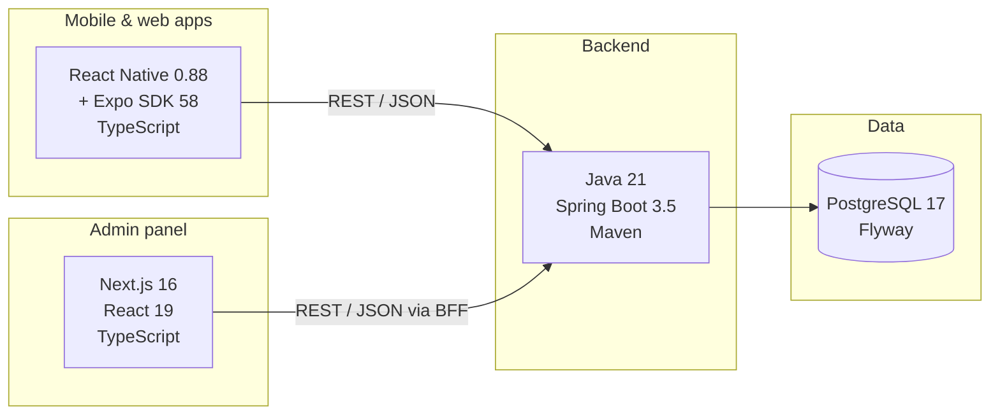

# Technology Stack

Every technology BUZZER uses, **what it is in plain words**, and **why we chose it**.
Related: [Architecture](architecture.md) · [Developer guide](developer-guide.md)

---

## At a glance

| Layer | Technology | Version |
|---|---|---|
| Backend language | Java | 21 (LTS; also runs on 25) |
| Backend framework | Spring Boot | 3.5.16 |
| Build tool (backend) | Maven | 3.9+ |
| Database | PostgreSQL | 17 |
| DB migrations | Flyway | (managed by Spring Boot) |
| Mobile apps | React Native + Expo | RN 0.88.1 · Expo SDK 58 |
| Admin web | Next.js + React | Next 16.4.5 · React 19.3 |
| Language (front ends) | TypeScript | 5 / 6 |
| Excel | Apache POI | 5.5.1 |
| API docs | springdoc-openapi (Swagger UI) | 2.8.9 |
| Metrics | Micrometer + Prometheus | (managed) |
| Local/test database | Zonky embedded PostgreSQL | 2.2.2 (PG 17.11 binaries) |
| CI | GitHub Actions | — |
| Containers | Docker, Docker Compose, Kubernetes manifests | — |

---

## Backend

| Technology | In plain words | Why we use it |
|---|---|---|
| **Java 21** | A mature, fast, strongly-typed language used by banks and big platforms | Reliable, huge talent pool in India, long-term support |
| **Spring Boot 3.5** | The most popular Java framework for building web APIs | Security, validation, transactions, monitoring all built in |
| **Spring Web (REST)** | Turns Java methods into HTTP endpoints (`/api/v1/...`) | Simple JSON APIs every app can call |
| **Spring Security + OAuth2 Resource Server (Nimbus JWT)** | Checks who is calling and what they may do | Industry-standard JWT tokens, role checks on each method |
| **Spring JDBC – `JdbcClient`** | Runs SQL directly (no ORM) | Predictable queries and explicit locking for money and assignment logic |
| **Bean Validation** | Declarative input rules (`@NotBlank`, `@Size`…) | Bad input is rejected before it reaches business code |
| **Flyway** | Versioned database change scripts (`V1__…sql`, `V2__…sql`) | Every environment's schema is identical and reproducible |
| **Jackson** (snake_case) | Converts Java objects ⇄ JSON | Consistent `snake_case` JSON across all APIs |
| **Apache POI** | Reads/writes Excel `.xlsx` files | Catalogue, commission and partner price-list Excel import/export |
| **springdoc-openapi** | Auto-generated API documentation | Live Swagger UI at `/swagger-ui.html` |
| **Spring Actuator + Micrometer + Prometheus** | Health checks and metrics | Monitoring, alerting, the System Health page |
| **Maven** | Builds, tests and packages the backend | Standard for Java; works in CI with one command |

## Database

| Technology | In plain words | Why we use it |
|---|---|---|
| **PostgreSQL 17** | A powerful open-source relational database | Transactions, JSONB for dynamic forms, partial unique indexes that enforce business rules |
| **JSONB columns** | Flexible JSON stored inside tables | Dynamic request forms, line items, agent preferences — without schema changes per category |
| **Partial unique indexes** | "Only one row may be X" rules inside the DB | Exactly one live assignment per request, one accepted quote, one primary agent… |
| **Embedded PostgreSQL (Zonky)** | A real PostgreSQL started automatically by Java | Local development and tests need **no Docker and no DB install** |

## Mobile apps (Customer, Partner, Agent)

| Technology | In plain words | Why we use it |
|---|---|---|
| **React Native** | Write the app once in JavaScript/TypeScript, get real Android and iOS apps | One team, three platforms |
| **Expo SDK 58** | Toolkit around React Native (build, run, update, device APIs) | Fast development, easy store builds (EAS), web export for testing |
| **react-native-web** | Runs the same apps in a browser | Agent app works on desktop; easy testing at localhost |
| **TypeScript** | JavaScript with types | Fewer bugs; editors catch mistakes early |
| **npm workspaces** | Several apps share one `mobile/` repo | Shared `@buzzer/core` package: design system, API client, auth, navigation, forms |
| **expo-secure-store** | Encrypted storage on the phone | Login tokens kept safely |
| **expo-location** | Phone GPS | "Use current location" for addresses and agent matching |
| **expo-linear-gradient** | Gradient backgrounds | BUZZER green brand look |

## Admin panel

| Technology | In plain words | Why we use it |
|---|---|---|
| **Next.js 16 (App Router)** | React framework with a built-in server | Fast admin UI + a small server layer (BFF) for secure sessions |
| **React 19** | UI library | Component-based, widely known |
| **BFF pattern** | The admin's own server keeps the login tokens in httpOnly cookies and forwards calls | Tokens are never exposed to browser JavaScript |
| **Exports** | Excel (server-side via POI), CSV, PDF (print) | Every table can be downloaded |

## Design

| Item | Detail |
|---|---|
| Design tokens | [`design/tokens.json`](../design/tokens.json) — Forest `#064E32`, Emerald `#087D48`, Secondary `#119B50`, Light green `#E8F6EC`, Pale mint `#F2FAF4` |
| Rule | Green identity only — no blue/purple/orange as primary colours |
| Shared UI kit | `mobile/packages/core/src/ui.tsx` (buttons, cards, chips, headers, tabs…) |

## DevOps & quality

| Technology | Use |
|---|---|
| **Git + GitHub** | Source control; feature branches + pull requests (never push to `main`) |
| **GitHub Actions** | CI: backend tests, admin production build, mobile typecheck + web bundles ([`.github/workflows/ci.yml`](../.github/workflows/ci.yml)) |
| **JUnit 5 + Spring Boot Test + MockMvc** | 41 integration tests against real PostgreSQL |
| **Docker / Docker Compose** | [`infra/docker-compose.yml`](../infra/docker-compose.yml) for a containerised stack |
| **Kubernetes** | Reference manifest [`infra/k8s/backend.yaml`](../infra/k8s/backend.yaml) (replicas, probes, resources) |
| **EditorConfig** | Consistent formatting across editors |

## External services (adapters ready, credentials needed)

| Service | Today | Production options |
|---|---|---|
| Payments | Test-mode mock gateway with signed webhooks | Razorpay, Cashfree, PayU |
| SMS / OTP delivery | Logs redacted messages | MSG91, Gupshup, Twilio (DLT-registered) |
| WhatsApp | Not connected | WhatsApp Business API (Gupshup, Meta Cloud API) |
| Push notifications | In-app only | Firebase Cloud Messaging |
| Email | Not connected | Amazon SES, SendGrid |
| Maps / geocoding | Device GPS + nearest locality | Google Maps Platform |
| File storage | Small images in the DB media library | S3-compatible object storage + CDN |
