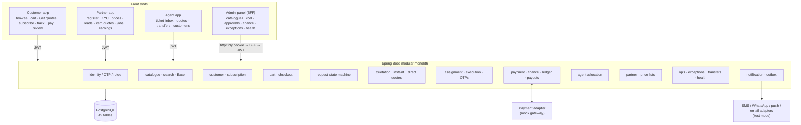

# BUZZER Transformation — Audit of the Existing Application

**Goal:** evolve BUZZER into *One App. Every Local Need. — Products. Services. People. Assistance.* without rebuilding
what already works. This document is **Stage 1 (audit)** of the transformation master prompt. **No code has been changed
for the transformation yet.** The proposed architecture, database impact and stage plan are in
[transformation-plan.md](transformation-plan.md) (Stage 2).

Audit date: 7 Nov 2026 · Branch: `feature/buzzer-platform-mvp` (commit `bf90262`) · Repository: `weetecnologias/BUZZER`

---

## 1. The system today in numbers

| Item | Today |
|---|---|
| Applications | 4 front ends + 1 backend: Customer app, Partner app, Agent app (Expo / React Native, Android · iOS · web), Admin panel (Next.js), Spring Boot API |
| Backend | Java 21, Spring Boot 3.5 modular monolith, 17 modules, **174 REST endpoints** under `/api/v1` |
| Database | PostgreSQL 17, **49 tables**, Flyway migrations **V1–V9** + dev-only seeds V1000–V1002 |
| Catalogue | 26 categories (25 launch + Hardware & Supplies), ~65 subcategories, ~300 priced menu items, 9 pricing types, dynamic forms |
| Tests | **44 backend integration tests** on real PostgreSQL; TypeScript strict typecheck on all apps; admin production build. **No automated UI tests.** |
| Integrations | Payments, SMS, WhatsApp, push, email, maps, file storage: **test mode / not connected** (adapters ready) |
| Cities | Hyderabad (multi-city ready by configuration) |

## 2. Current-system architecture

Today **everything a customer buys is a "service request"**: one `service_requests` row moves through a 24-state
lifecycle (request → quotes → approval → payment → assignment → OTP start/complete → settlement).

## 3. Existing features (what is built and working)

| Area | Features |
|---|---|
| **Identity** | Mobile OTP sign-up/login (hashed, rate-limited), JWT + rotating refresh tokens, 8 roles, per-app access rules |
| **Customer app** | Welcome: *Subscribe for a dedicated agent* / *Explore*; language-matched agent; home with agent card, categories, deals, search; priced menus with menu groups; cart + extra items; **Get quotes** (direct to partners) or **Send to my agent**; wishlist; write-to-agent; requirement forms; quote comparison (item-level), revise, accept, pay online / on delivery (test mode); OTP display; reschedule; cancel; review; addresses with current location; notifications; profile |
| **Partner app** | Registration (individual/business), terms, KYC (masked), service capability requests, **Services & prices** price list, leads with NEW / revision highlights, item-by-item quotes, standard quotes, jobs (confirm, arrive, START/COMPLETE OTP, reschedule, cancel), earnings ledger, payouts |
| **Agent app** | Ticket inbox (New / Needs action / Automated / With customer / In progress / Closed), SLA countdown, request workspace, eligible partners, invitations, instant quotes from price lists, share quotes, take over, transfer, OTP override, messages, call log, timeline, customer portfolio, register customer, create request on behalf |
| **Admin panel** | Dashboard, requests (+transfer), customers (plan, languages), agents (wings, managers), partners & KYC, price-list approvals, coverage, catalogue (tree, images, menu groups, **Excel import/export**), finance (commission rules + Excel, payouts, refunds, payments, reports), exceptions (assign/transfer), settings & SLA, system health; Excel/CSV/PDF exports |
| **Platform** | State machine + full timeline/audit, exclusive assignment (DB-enforced), idempotency, append-only ledger, commission precedence, outbox with retries/dead-letter, SLA escalation, automatic hand-over, system health, CI pipeline, Docker/K8s manifests, runbooks |

## 4. Known gaps, bugs and technical debt

| # | Item | Impact | Note |
|---|---|---|---|
| 1 | **No product model** — items are "services" (no brand, SKU, specs, variants in use, stock) | Blocks Vertical A | `service_variants` table exists but is unused by cart/checkout |
| 2 | **No order aggregate** — direct purchases must go through the service-request lifecycle (START/COMPLETE OTP etc.) | Awkward for products | Needs `orders` + fulfilment (pickup / delivery) |
| 3 | **Partners have no location, opening hours, delivery radius, pickup flag** | Blocks shop discovery ("near me") | `partners` has only city + free-text address |
| 4 | **No stock / availability per vendor** — availability is confirmed per quote only | Blocks direct purchase & price comparison | `partner_price_items` has price, no stock/MOQ |
| 5 | **Search is basic substring matching** (`ILIKE '%q%'`), no typo tolerance, synonyms, ranking or index | Poor product search at scale | Plan: PostgreSQL full-text + `pg_trgm` + synonyms |
| 6 | **No delivery management** — no delivery tasks, riders, fees by distance, tracking | Blocks BUZZER-arranged delivery | Delivery personnel exist only as a future service category |
| 7 | Payments, SMS, WhatsApp, push, email, maps, file storage in **test mode** | Launch blocker | Credentials/accounts needed |
| 8 | Images stored in the DB media library (≤ 2 MB) | Won't scale for product photos | Move to object storage + CDN |
| 9 | No automated UI / end-to-end tests | Regression risk during transformation | Add Playwright (admin) + Maestro/Detox (mobile) |
| 10 | Per-instance API rate limiter (OTP limits are DB-backed) | Multi-instance deployments | Redis planned |
| 11 | Service date/time is free text (`YYYY-MM-DD HH:mm`) in the cart | UX | Slot picker needed for Vertical B step 4 |
| 12 | Customer cannot **choose a provider** from matches — only from quotes | Vertical B step 5–6 | Show eligible providers with ratings & listed prices |
| 13 | Quick Jobs & Staffing is only a requirement form | Not part of the four verticals | Keep as a service category; hiring/staffing is out of scope for this transformation |
| 14b | Notification texts are hard-coded in Java | Blocks configurable templates (§12 of the prompt) | `notification_templates` table, events → templates |
| 14c | No complaints/disputes module (only DISPUTED state and refunds) | Blocks Stage 9/§18-L | Shared complaints & disputes tables + admin screens |
| 14d | No attachment upload for customers (photos, BOQs, prescriptions) | Blocks RFQ attachments | Private attachment storage; DB-backed first, object storage later |
| 14 | Mixed CRLF/LF line endings after branch switch on Windows | Noise in diffs | Add `.gitattributes` |
| 15 | Manager's "NEW" highlight reflects the handling agent's seen-state, not the manager's | Minor | Per-viewer seen tracking if needed |

## 5. Mapping the new business model onto what exists

Legend: ✅ exists · 🟡 partly exists — extend · 🆕 new

### Vertical A — BUZZER Marketplace

| Capability | Status | Where today | Proposed action |
|---|---|---|---|
| Dynamic categories/subcategories (admin-managed, not hard-coded) | ✅ | `catalogue` module, admin catalogue + Excel | Add a `vertical` tag (MARKETPLACE / SERVICES / ASSISTANT / …) so the app can show each vertical separately |
| 12 initial marketplace categories | 🟡 | Hardware & Supplies covers parts of 1–3 | Seed the 12 categories through a migration (editable afterwards); medical behind a licence flag |
| Local shop discovery | 🆕 | — | Extend `partners`: `partner_kind` (SHOP / SERVICE_PROVIDER / BOTH), latitude/longitude, opening hours, delivery radius, pickup/delivery flags; "shops near me" API |
| Product catalogue, specs, variants | 🟡 | `service_items` (+ unused `service_variants`) | New `products` (brand, specs JSON, images) + `product_variants` (size/colour/pack, SKU), linked to the same category tree |
| Product search | 🟡 | Substring search | Full-text + trigram + synonyms (see §4 #5) |
| Vendor price comparison | 🟡 | `partner_price_items` (price per partner per item, admin-approved) | Evolve into **vendor listings**: price, MRP, stock status, MOQ, wholesale price tiers, delivery options; compare across nearby shops |
| Direct product purchase | 🆕 | Cart only creates service requests | New **orders** aggregate (order → items → fulfilment → payment → invoice); cart splits by vendor |
| Multi-vendor RFQ | ✅ | **Get quotes** (`DirectQuoteService`): auto-dispatch, item-level availability + price, revisions, hand-over | Reuse for products (lines reference product variants instead of service items) |
| Bulk / wholesale enquiries | 🟡 | RFQ supports quantities up to 999 per line | Add a "bulk/wholesale" flag, higher quantities, GST details, route to wholesalers/distributors |
| Customer pickup | 🆕 | — | Fulfilment type PICKUP with pickup code (reuse the OTP service) |
| Vendor-managed delivery | 🟡 | Partner sets delivery fee/time in item quotes | Fulfilment type VENDOR_DELIVERY with tracking statuses |
| Selective BUZZER-arranged delivery | 🆕 | — | Delivery tasks assigned to delivery partners; fee by distance |

### Vertical B — BUZZER Services

| Step | Status | Where today | Proposed action |
|---|---|---|---|
| 1–3 Select service, requirement, location | ✅ | Menus, dynamic forms, addresses + GPS | Keep |
| 4 Preferred date and time | 🟡 | Free-text date | Slot picker; partner availability calendar later |
| 5 Provider matches or quotations | 🟡 | Quotations ✅; matches ❌ | Show eligible providers (rating, distance, listed price) |
| 6 Select provider | 🟡 | Accept a quote | "Book this provider" at listed price → instant assignment |
| 7–9 Confirm, track, complete | ✅ | Assignment, booking, START/COMPLETE OTP | Add live location later (maps) |
| 10 Pay and review | ✅ | Online / pay on delivery (test mode), reviews | Real gateway |
| Fixed-price and quotation services | ✅ | 9 pricing types, Get quotes, agent quotes | Keep |

### Vertical C — BUZZER Personal Assistant

| Requirement | Status | Where today | Proposed action |
|---|---|---|---|
| Self-service for all customers | ✅ | Explore mode, menus, Get quotes, cart | Keep |
| Request human assistance when needed | ✅ | *Write to my agent*, Special Requests, automatic hand-over | Also available to non-subscribers via on-duty agents (exists) |
| Eligible/subscribed customers get a dedicated primary agent | ✅ | Welcome → Subscribe, `AgentSubscriptionService` | Add *eligibility* rules (admin-granted) next to subscription |
| Backup agent for each dedicated customer | ✅ | `customer_agent_links` BACKUP | Keep |
| Admin manual allocation / reassignment | ✅ | Admin → Customers → Reassign agent | Add bulk reassignment per wing |
| Auto-allocation by workload, location, availability, preference | ✅ | Allocation ranking (city, locality, first-choice language, languages, availability, load) | Add customer-preferred agent gender/name requests if needed |
| SLA 1–2 h escalation to manager and/or backup | ✅ | `EscalationService` (backup → best available → manager), SLA rules per priority | Make the default 60–120 min configurable per vertical |
| Agents assist with products, RFQs, bookings, vendor follow-ups, orders | 🟡 | Services, quotes, instant quotes, transfers | Extend to product RFQs, orders and tasks (Stage 7) |
| Agent actions recorded in an activity log | 🟡 | `request_status_history`, `audit_events`, call log, messages | One **agent activity log** view per agent and per customer |
| Agents cannot confirm orders, payments or quotes without authorisation | 🟡 | Accept/pay endpoints are customer-only; agent-created requests need customer confirmation | Formalise as **agent drafts → customer approval** for RFQs, orders, bookings, tasks |
| Paid membership in future, never mandatory | ✅ | Subscription is free and optional | Membership plans table + payment later (Stage 9) |

### Vertical D — BUZZER Tasks & Errands

| Requirement | Status | Where today | Proposed action |
|---|---|---|---|
| Document pickup/delivery, parcel collection, product collection, store-to-home delivery, purchase assistance, appointment coordination | 🟡 | Daily Errands / Delivery & Logistics categories exist as menus that become service requests; Special Requests | New **task** domain with pickup and drop-off points, items, instructions |
| Request → verification → allocation → acceptance → pickup → in progress → completion proof → customer confirmation | 🆕 | — | Task state machine of its own (not the service lifecycle) |
| Task partners (verification, availability, accept/reject, instructions, completion OTP/proof, earnings) | 🟡 | Partner registration, KYC, availability, OTPs, earnings ledger | New partner role *Task & delivery partner* reusing those pieces |
| Pricing, service fees, partner payments | 🟡 | Ledger, commissions, payouts | Task fee rules (base + distance), commission scope TASK |
| Cancellation rules, dispute handling | 🟡 | Request cancellation with reason, DISPUTED state, refunds with approval | Task cancellation fees; shared complaints & disputes module |

## 6. Retain · Modify · New · Deprecate

| Retain as is | Modify / extend | New | Deprecate (after migration, not deleted) |
|---|---|---|---|
| OTP auth, roles, JWT/BFF security | `partners` → shops with geo, hours, fulfilment options | Products & variants | `SELF` booking mode ("Book now at listed prices" via agent) — replaced by direct purchase / Get quotes |
| Request state machine, timeline, audit | `partner_price_items` → vendor listings (stock, MOQ, tiers) | Orders, order items, fulfilments | Free-text date entry |
| Exclusive assignment, OTP execution | Cart → splits into product orders vs service requests | Shop discovery & comparison APIs/screens | Single search endpoint (kept as fallback) |
| Ledger, commissions (+Excel), payouts, refunds | Search → full-text + fuzzy | Delivery tasks & delivery partner flow | |
| Agent subscription, inbox, transfers, wings | Categories → `vertical` tag | Pickup codes | |
| Direct quotes (RFQ engine) | RFQ lines → product variants | Wholesale/bulk RFQ | |
| Catalogue Excel, media, exports | Commission rules → per vertical / product category | Vendor storefront page | |
| System health, outbox, exceptions | Partner app → Shop mode (orders, stock) | Admin: products, shops, orders, deliveries | |

## 7. Database changes required (all additive)

Rules: **new migrations only (V10+), never edit applied ones, never drop or reset data**; new columns are nullable
or defaulted; old structures stay until every client has moved; backfill in migrations.

| Change | Tables |
|---|---|
| Vertical tagging | `categories.vertical` (default `SERVICES`; Hardware → `MARKETPLACE`) |
| Shops | `partners.partner_kind`, `latitude`, `longitude`, `opening_hours JSONB`, `delivery_radius_km`, `offers_pickup`, `offers_delivery`, `gstin`; `partner_categories` for shop categories |
| Products | `brands`, `products` (category/subcategory, brand, name, description, specs JSONB, images), `product_variants` (SKU, attributes JSONB, MRP, unit) |
| Vendor listings | `vendor_listings` (partner, variant, price, MRP, stock status, MOQ, wholesale tiers JSONB, approval) — `partner_price_items` kept and mapped |
| Orders | `orders`, `order_items`, `order_status_history`, `fulfilments` (PICKUP / VENDOR_DELIVERY / BUZZER_DELIVERY, codes, slots) |
| Delivery | `delivery_tasks` (order, rider partner, pickup/drop, fee, status, timestamps) |
| Money | `payments.order_id` (nullable) + purpose `ORDER`; ledger postings for orders; invoices for orders |
| Reviews | `reviews.order_id` (nullable) for shop reviews |
| Search | `pg_trgm` extension, generated `tsvector` columns + GIN indexes on products/items, `search_synonyms` |

## 8. API changes required (additive; `/api/v1` stays backward compatible)

| New / changed | Purpose |
|---|---|
| `GET /marketplace/shops?lat&lng&category` | Shops near me |
| `GET /marketplace/products?q&category`, `GET /marketplace/products/{id}` | Product search and detail **with offers from nearby shops** (price comparison) |
| `POST /customer/orders`, `GET /customer/orders/{id}` | Direct purchase with fulfilment choice |
| `/partner/listings`, `/partner/orders` | Shop stock/prices and order handling |
| `/partner/deliveries` | Delivery partner tasks |
| `/admin/products`, `/admin/shops`, `/admin/orders`, `/admin/deliveries` | Management (+ Excel) |
| `POST /customer/cart/checkout` | Gains product lines; existing modes unchanged |
| `GET /catalogue/categories?vertical=` | Optional filter; default response unchanged |

## 9. Migration and compatibility risks

| Risk | Mitigation |
|---|---|
| Existing customers, partners, agents and transactions | Additive migrations only; backfills tested on a copy of production data; point-in-time backup before each release |
| Two purchase models (service requests vs product orders) confuse people and code | Clear rule: **services and RFQs → service requests; fixed-price product purchases → orders**; shared payment/ledger |
| Older app versions in stores | Keep API fields and endpoints; new fields optional; feature flags per vertical |
| Price-list → listings migration | Keep `partner_price_items`; create listings alongside; switch readers gradually |
| Regulated categories (medical) | Licence fields + admin verification before listing; advisory notices (pattern exists) |
| Tax/GST on goods | Professional review; invoice per vendor order |
| Delivery liability and payouts | Separate delivery fee ledger lines and delivery-partner payouts |
| Search performance at catalogue scale | Indexes + pagination; load test before launch |
| Scope size | Deliver in phases (§10), each with tests and a report |

## 10. Plan and decisions

The staged implementation plan (Stages 2–10 of the master prompt), the updated architecture, ER and navigation
diagrams, the request-engine design and the decisions needed are in **[transformation-plan.md](transformation-plan.md)**.
