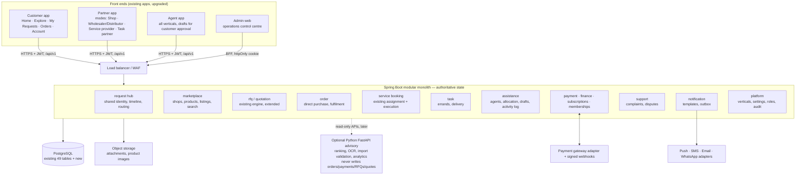
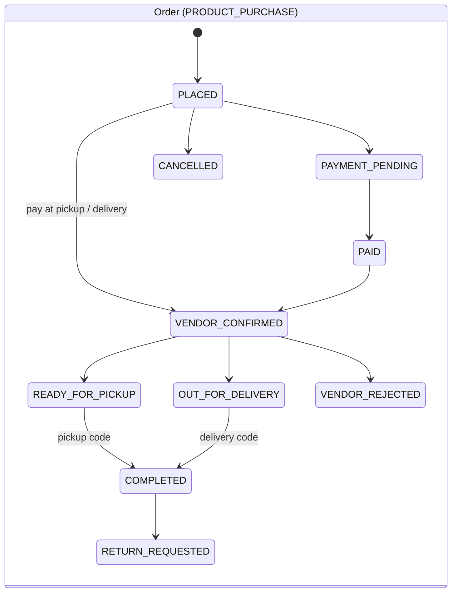
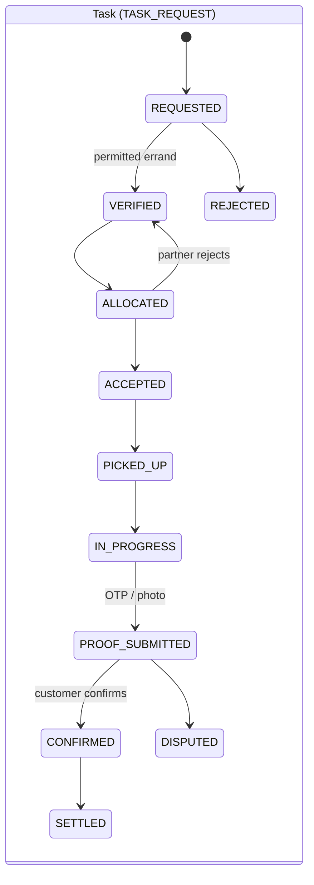
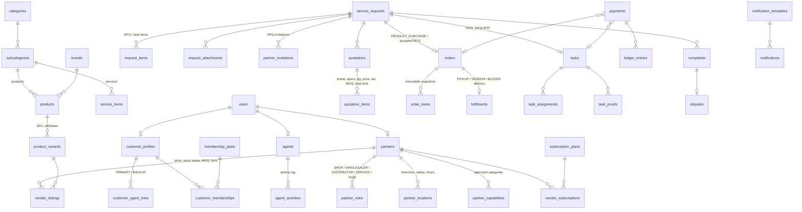
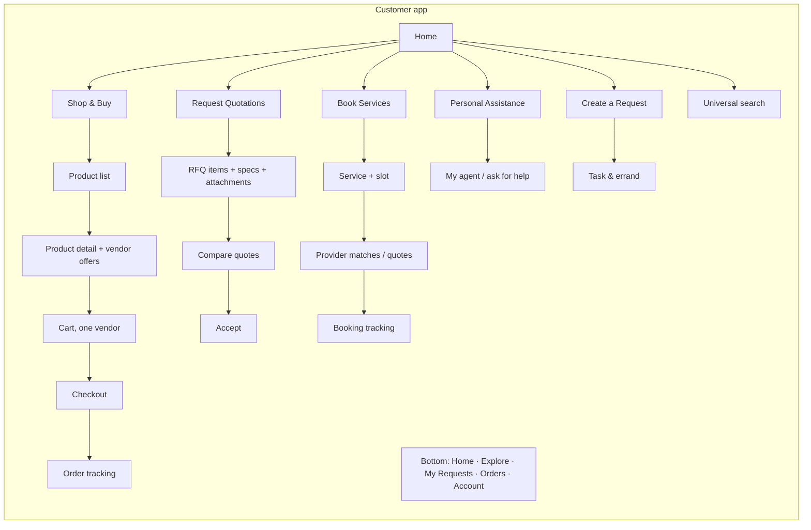
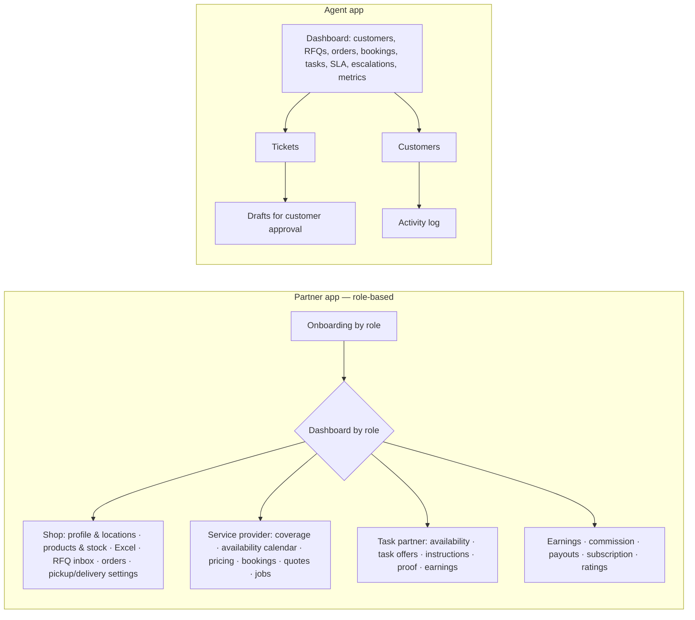

# BUZZER Transformation — Stage 2: Architecture, Database Impact & Implementation Plan

*One App. Every Local Need. — Products. Services. People. Assistance. — You Buzz. We Get It Done.*

Companion to the [Stage 1 audit](transformation-audit.md). **Status: approved (all recommended decisions in [§12](#12-decisions-for-approval)). Progress is tracked in
[transformation-progress.md](transformation-progress.md).**

---

## 1. Approach in one paragraph

Evolve, don't rebuild. The existing Spring Boot modular monolith, PostgreSQL schema, four apps, OTP/roles security,
ledger, commissions, agent system and the **Get quotes** engine stay. Each stage adds tables with **additive
migrations (V10+)**, adds endpoints under `/api/v1` without breaking old ones, upgrades the existing screens, and is
hidden behind a **vertical/feature switch** until its acceptance tests pass. Python FastAPI is **not** introduced until a
concrete need (OCR, catalogue-import validation, ranking) appears; when it is, it stays advisory and never writes
order, payment, RFQ or quotation state.

## 2. Old vs new — feature comparison

| Area | Today | After transformation |
|---|---|---|
| Positioning | Personal-assistant service app | Local commerce + services + tasks + assistance — *one app for every local need* |
| Customer home | Agent card, categories, deals, search | "What do you need today?", universal search, 4 cards (Shop & Buy · Request Quotations · Book Services · Personal Assistance), nearby shops, active orders, *Create a Request* |
| Customer navigation | Home · Requests · Updates · Profile | Home · Explore · My Requests · Orders · Account (notifications in header) |
| What can be bought | Services (menu items), quotes | **Products from local shops** (direct purchase, RFQ, bulk/wholesale) + services + tasks |
| Request model | One lifecycle for everything (`service_requests`) | **Shared request identity** + separate state machines: purchase, RFQ, service booking, task, assistance |
| RFQ | Get quotes: item availability + price, revisions, auto hand-over | + brand/specs, discount, taxes, MOQ, lead time, validity, terms, attachments; 5–10 vendors configurable per category/locality; one accepted vendor per RFQ |
| Partners | Service providers (individual/business) | Retail shops, wholesalers, distributors, service providers, task & delivery partners — role-specific onboarding and dashboards |
| Shops | — | Location(s), service radius, hours, pickup/delivery settings, product & stock management, Excel upload |
| Orders | — | One vendor per cart, immutable price/tax/product/fulfilment snapshots, pickup / vendor delivery / BUZZER delivery |
| Tasks & errands | Errand menus handled as service requests | Task domain: pickup → drop, verification, allocation, proof, customer confirmation |
| Personal assistant | Optional dedicated agent, backup, SLA escalation, transfers | + assists across all verticals via **drafts the customer approves**; agent activity log; membership plans (paid later) |
| Search | Substring on service names | Full-text + fuzzy across products, shops, services; intent routing suggestions (never auto-commits) |
| Notifications | Hard-coded texts; in-app + test-mode SMS | Template table per event/channel/audience; push, SMS, email, WhatsApp (official API) adapters |
| Money | Service payments, commissions, payouts, refunds | + order/task payments, vendor subscriptions, RFQ lead fees, featured listings, memberships — all configurable, pilot free for customers |
| Support | Messages, exceptions | Complaints & disputes modules for all verticals |
| Admin | 12 modules | 26 modules incl. vertical switches, product moderation, orders, tasks, delivery config, campaigns, roles & permissions |

## 3. Updated system architecture

## 4. Unified request engine

**Shared identity, separate lifecycles.** The existing `service_requests` table already holds request number,
customer, category, description, location, priority, preferred schedule, agent, status and full status history, and its
`status` column has no fixed constraint. It becomes the **request hub** (a `requests` view gives it the new name;
the table name stays so nothing breaks).

| New hub column | Purpose |
|---|---|
| `request_type` | `PRODUCT_PURCHASE`, `PRODUCT_RFQ`, `SERVICE_BOOKING`, `TASK_REQUEST`, `PERSONAL_ASSISTANCE` (backfilled from booking mode + category vertical) |
| `vertical` | MARKETPLACE / SERVICES / TASKS / ASSISTANCE (from category) |
| `parent_request_id` | Assistance cases spawn child requests (an RFQ, a booking, an order) |
| `assigned_partner_id` | Denormalised current partner for listings |
| `domain_ref` | Points to `orders.id` / `tasks.id` for the new domains |
| `request_attachments` (table) | Files attached to any request |

Each type keeps **its own state machine** in its own module; the hub's `status` mirrors the domain status and every
change writes the shared timeline (`request_status_history`), so one tracking screen works for all types.

| Type | Lifecycle owner | States (summary) |
|---|---|---|
| `SERVICE_BOOKING` | existing `RequestStatus` (unchanged) | created → quotes / provider selection → approval → payment → assigned → confirmed → arrived → started → completed → settled |
| `PRODUCT_RFQ` | existing `RequestStatus` + RFQ rules | created → vendors invited → quoting → customer comparing → accepted (one vendor) → paid → **converted to an order** |
| `PRODUCT_PURCHASE` | new `OrderStatus` | see below |
| `TASK_REQUEST` | new `TaskStatus` | see below |
| `PERSONAL_ASSISTANCE` | `AssistanceStatus` | open → agent working → waiting on customer → resolved (children carry the real work) |

**Authorisation rule (Vertical C).** Agents create **drafts** (RFQ lists, bookings, orders, tasks) flagged
`awaiting_customer_approval`; only the customer's own action (or recorded consent captured by the existing consent
fields) can submit, accept a quote, confirm an order or pay. Enforced server-side on every accept/confirm/pay endpoint.

**Universal search routing.** `GET /search?q=` returns products, shops and services plus a *suggested workflow*
(e.g. "leaking tap" → Book Services › Plumber; "50 bags cement" → Request Quotations, bulk). Suggestions are links;
nothing is created until the customer confirms.

## 5. Updated ER diagram (new and changed tables)

### Prompt §13 entity list → database decision

| Entity | Decision | Table(s) |
|---|---|---|
| Users, customer profiles, addresses | **Reuse** | `users`, `customer_profiles`, `addresses` |
| Vendors, vendor locations, vendor capabilities | **Extend + new** | `partners` + `partner_roles`, `partner_locations` (lat/lng, radius, hours, pickup/delivery), `partner_capabilities` (reuse) |
| Categories | **Extend** | `categories.vertical`, `enabled`, `rfq_invite_count`, licence flag |
| Products, product variants | **New** (reuse unused `service_variants` pattern) | `brands`, `products`, `product_variants` |
| Vendor listings | **New**, `partner_price_items` kept for services | `vendor_listings` |
| Carts, cart items | **Reuse + new** | `cart_items` (services/RFQ basket, unchanged); `product_carts`, `product_cart_items` (one vendor per cart) |
| RFQs, RFQ items, RFQ invitations | **Reuse + new** | hub row (`request_type = PRODUCT_RFQ`), `request_items` (new, normalised), `partner_invitations` (reuse) |
| Quotes, quote items | **Reuse + new** | `quotations` (+ discount, tax, validity, terms already), `quotation_items` (new; JSON `line_items` kept during transition) |
| Orders, order items | **New** | `orders`, `order_items`, `fulfilments`, `order_status_history` via shared timeline |
| Service providers, service categories, service bookings | **Reuse** | `partners` with SERVICE role, `subcategories`, `assignments` + `bookings`; new `partner_availability` |
| Tasks, task assignments | **New** | `tasks`, `task_assignments`, `task_proofs`, `task_fee_rules` |
| Agent profiles, agent customer assignments, agent workload | **Reuse** | `agents`, `customer_agent_links`; workload view; new `agent_activities` |
| Payments, refunds, commission rules, ledger entries | **Extend** | `payments` (+`order_id`, `task_id`, purposes), `refunds`, `commission_rules` (+ scopes VENDOR, SERVICE_TYPE, TASK, VERTICAL), `ledger_entries` |
| Subscriptions, memberships | **New** | `subscription_plans`, `vendor_subscriptions`, `membership_plans`, `customer_memberships` |
| Notifications | **Extend** | `notifications`, `outbox_events` + new `notification_templates` |
| Reviews | **Extend** | `reviews` (+ `order_id`, `task_id`, `partner_id` target) |
| Complaints | **New** | `complaints`, `disputes`, `complaint_messages` |
| Audit events | **Reuse** | `audit_events` |
| Vertical switches | **New** | `platform_verticals` (code, enabled, order) |

## 6. Navigation diagrams

## 7. Screen inventory and status

### Customer (prompt §5)

| # | Screen | Today | Stage |
|---|---|---|---|
| 1–2 | Login/registration, OTP | ✅ | — |
| 3–4 | Profile, saved addresses | ✅ | 3 (polish) |
| 5 | Home dashboard | 🟡 redesign | 3 |
| 6 | Universal search | 🟡 | 3 + 5 |
| 7 | Dynamic category listing | ✅ | 3 (vertical filters) |
| 8–10 | Product listing, product details, vendor profile | 🆕 | 5 |
| 11–12 | Cart, checkout | 🟡 (services) | 5 (one-vendor product cart) |
| 13–18 | RFQ creation, item specs, attachments, status, comparison, acceptance | 🟡 Get quotes | 5 |
| 19–21 | Service discovery, booking, provider profile | 🟡 | 6 |
| 22 | Task & errand creation | 🆕 | 8 |
| 23–24 | Agent assistance request, my dedicated agent | ✅ | 7 (drafts, activity) |
| 25 | Order tracking | 🆕 | 5 |
| 26 | Payment history | 🆕 (data exists) | 9 |
| 27 | Notifications | ✅ | 3 (header) |
| 28 | Complaints & support | 🆕 | 9 |
| 29 | Ratings & reviews | 🟡 (services) | 5–8 |
| 30 | Membership & subscriptions | 🟡 (free subscription) | 9 |

### Partner (prompt §6)

| Group | Today | New / upgrade (stage) |
|---|---|---|
| Onboarding & KYC | ✅ generic | Role-specific onboarding (5, 6, 8) |
| Shop/vendor | 🟡 price list only | Shop profile, locations & radius, categories, products & variants, price & stock, Excel, RFQ inbox (✅ leads), quotes/revisions (✅), orders, customer messages, pickup/delivery settings, subscription (5, 9) |
| Service provider | ✅ leads, quotes, jobs, OTPs, earnings | Availability calendar, pricing config, booking requests accept/reject, completion evidence (6) |
| Task partner | 🆕 | Verification, availability, task offers accept/reject, instructions, status, OTP/proof, earnings (8) |

### Agent (prompt §7)

| Item | Today | Stage |
|---|---|---|
| Dashboard: customers, active requests, SLA, escalations, metrics | ✅ | 7 adds RFQs, orders, bookings, tasks, pending customer responses, vendor follow-ups |
| Create requests with consent, compare options, track, escalate | ✅ services | 7 extends to all verticals as drafts |
| Primary/backup/manager escalation | ✅ | Keep |

### Admin (prompt §8 — 26 modules)

✅ exists: dashboard, customers, partner verification, agents, agent allocation (reassign), categories, subcategories,
payments & refunds, commission management, reports & exports, audit (backend), platform settings.
🟡 extend: vendor management (shops), quotation monitoring (requests), service bookings (requests), notifications (no campaigns), roles & permissions (fixed roles).
🆕 new: product moderation, RFQ management view, order management, task & errands, vendor subscriptions, customer membership, delivery configuration, complaints, disputes, campaigns, **vertical/category/service switches**, audit-log viewer.

## 8. Stage plan (prompt §17, Stages 3–10)

Every stage: additive migration(s) · API contracts in OpenAPI · backend + frontend together · automated tests ·
existing 44 tests stay green · docs + progress report · rollback = feature switch off + app hides entry points
(schema stays, data kept).

### Stage 3 — Unified UI/UX & navigation
- **Customer:** new Home ("What do you need today?", universal search box, 4 cards, Create a Request, nearby shops placeholder until Stage 5, recent requests, active orders, my assistant); bottom nav Home · Explore · My Requests · Orders · Account; notifications in header.
- **Backend:** `platform_verticals` + `categories.vertical/enabled`; `GET /platform/verticals`; `GET /catalogue/categories?vertical=`; admin vertical switches.
- **Migration:** V10 (verticals, category vertical tag + backfill).
- **Tests:** vertical disabled → hidden from customer APIs; existing flows unchanged.
- **Files:** `mobile/apps/customer/App.tsx`, `screens/Home.tsx`, new `screens/Explore.tsx`, `screens/Orders.tsx` (shell), `catalogue/*`, new `platform` module, admin `settings` page.

### Stage 4 — Request engine
- Hub columns (`request_type`, `vertical`, `parent_request_id`, `domain_ref`), `request_attachments` (private storage), backfill types for existing rows.
- `GET /customer/requests?type=` with unified status; `POST /customer/requests/{id}/attachments`; shared timeline for all types.
- **Migration:** V11. **Tests:** backfill correctness on seeded data, attachments ownership (403 for others), list filters.

### Stage 5 — Marketplace & RFQ (largest)
- Partner roles & locations; products, variants, brands, vendor listings (+ Excel upload, admin moderation); shop discovery by distance; product search (full-text + `pg_trgm`); vendor price comparison.
- Direct purchase: one-vendor product cart, checkout with price/availability re-validation, `orders` + `order_items` snapshots, pickup / vendor delivery, order state machine, payments for orders (idempotent), vendor confirmation, completion codes.
- RFQ upgrade: `request_items` with specs & attachments, `quotation_items` (brand/specs, discount, tax, MOQ, lead time, validity, terms), invite 5–10 per category/locality (setting), compare, accept one vendor (transaction-safe) → order.
- **Migrations:** V12 (partners/locations/roles), V13 (products/listings/search indexes), V14 (orders/fulfilments), V15 (RFQ items/quote items).
- **Acceptance:** A (direct purchase), B (RFQ + acceptance), C (vendor quotation), I (admin vendor approval), M (vendors see only their orders/RFQs).

### Stage 6 — Services & provider workflows
- Slot picker, provider matches (eligible providers with rating, distance, listed price) → select provider → booking; provider availability calendar; booking accept/reject; completion evidence (photo/OTP).
- **Migration:** V16 (`partner_availability`, booking evidence). **Acceptance:** D (service booking & completion).

### Stage 7 — Agent & personal assistance
- Agent drafts for RFQs/orders/bookings/tasks requiring customer approval; agent activity log; dashboard across verticals; eligibility-based dedicated agents; SLA 60–120 min configurable per vertical.
- **Migration:** V17 (`agent_activities`, draft flags). **Acceptance:** F (allocation), G (backup coverage), H (SLA escalation), M (agents cannot accept/pay).

### Stage 8 — Tasks & errands
- Task creation (pickup/drop, items, instructions), verification rules, allocation to task partners (distance, availability), accept/reject, pickup → in progress → proof (OTP/photo) → customer confirmation; task fees (base + distance), cancellation fees; BUZZER-arranged delivery for orders = a linked task.
- **Migration:** V18 (`tasks`, `task_assignments`, `task_proofs`, `task_fee_rules`). **Acceptance:** E (task fulfilment).

### Stage 9 — Payments, commissions, subscriptions, support
- Commission scopes VENDOR / SERVICE_TYPE / TASK / VERTICAL with effective dates (+ Excel); RFQ lead fees, featured listings; vendor subscription plans; customer membership plans (free in pilot); payout statements; payment history; complaints & disputes; notification templates + campaigns.
- **Migrations:** V19 (plans/memberships), V20 (complaints/disputes), V21 (templates).
- **Acceptance:** J (commission & payout statements), K (payment failure & refund), L (cancellation & disputes).

### Stage 10 — Testing, migration, deployment
- Full regression of A–M + existing suites; UI end-to-end (Playwright admin, Maestro mobile); load test search/RFQ; production migration rehearsal on a copy of real data; deployment & rollback runbooks; README and progress report.

## 9. API contracts (summary — full OpenAPI per stage)

| Stage | Endpoints |
|---|---|
| 3 | `GET /platform/verticals`; `GET /catalogue/categories?vertical=`; `PUT /admin/platform/verticals/{code}` |
| 4 | `GET /customer/requests?type=&status=`; `POST/GET /customer/requests/{id}/attachments` |
| 5 | `GET /marketplace/shops?lat&lng&category`; `GET /marketplace/shops/{id}`; `GET /marketplace/products?q&category&page`; `GET /marketplace/products/{id}` (offers); `GET/PUT/DELETE /customer/product-cart`; `POST /customer/orders` (Idempotency-Key); `GET /customer/orders`, `/{id}`; `POST /customer/rfqs`; `/partner/listings` (+ `/excel`); `/partner/orders/*`; `/partner/locations`; `/admin/products`, `/admin/shops`, `/admin/orders` |
| 6 | `GET /services/{id}/providers?lat&lng&slot`; `POST /customer/bookings`; `/partner/availability`; `/partner/bookings/{id}/accept|reject|evidence` |
| 7 | `/agent/drafts` (create RFQ/order/booking/task drafts); `POST /customer/drafts/{id}/approve|reject`; `GET /agent/activity` |
| 8 | `POST /customer/tasks`; `GET /customer/tasks/{id}`; `/partner/tasks/*`; `/admin/tasks/*`, `/admin/task-fees` |
| 9 | `/admin/subscription-plans`, `/partner/subscription`; `/admin/membership-plans`, `/customer/membership`; `/customer/payments`; `/customer/complaints`, `/admin/complaints`, `/admin/disputes`; `/admin/notification-templates` |

## 10. Revenue configuration (prompt §16)

All rates live in `commission_rules` (and new fee/plan tables) with scope + effective dates; nothing hard-coded.
Customer-facing charges (delivery, task fee) are shown as separate lines before payment — **no undisclosed double
charging**: a vendor commission is never also charged to the customer. Pilot: customer marketplace access and
dedicated-agent membership are free (`membership_plans` price 0).

## 11. Rollback strategy

| Layer | How |
|---|---|
| Features | `platform_verticals` / settings switches hide a vertical instantly |
| Database | Additive migrations only; no column drops until a later "contract" release; backup + PITR before each release; migration rehearsal on production copy |
| API | Old endpoints and fields keep working; new fields optional |
| Apps | New screens behind vertical switches; previous store build keeps working against the API |
| Code | One stage per branch / PR; revert the merge if acceptance fails |

## 12. Decisions for approval

| # | Decision | Recommendation |
|---|---|---|
| 1 | Request hub: extend existing `service_requests` (+ `requests` view) **or** a new hub table with data migration | **Extend** — no data migration, all history kept |
| 2 | Partner app: one app with role-based modes **or** separate vendor app | **One app**, role-specific onboarding/dashboards |
| 3 | Python FastAPI advisory service | **Defer** until OCR/ranking/import validation is needed |
| 4 | BUZZER-arranged delivery | **Task partners (Vertical D)** do it — one delivery model for orders and errands |
| 5 | Payment collection for orders | Online via BUZZER gateway (escrow-style, payout to vendor) **plus** pay at pickup/delivery where the vendor allows |
| 6 | Medical & healthcare products | Category disabled until licence verification and legal review are in place |
| 7 | Start order | Stage 3 → 4 → 5 as above, each reported and approved before the next |
